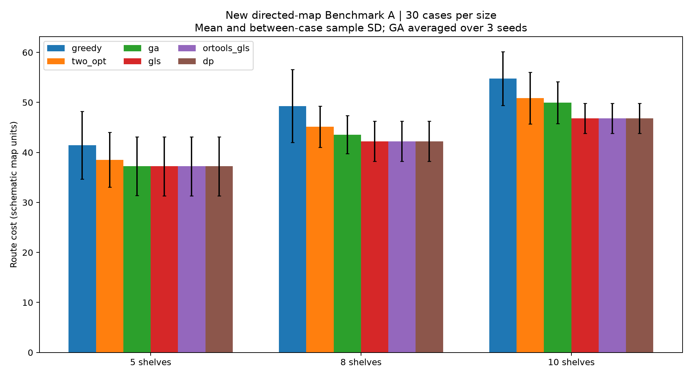

# SmartCart route planner

A Python supermarket cart simulator with directed aisle navigation, A* shortest paths,
and exact subset dynamic programming for joint pickup-stop selection and ordering.
The layout is schematic and is not a surveyed physical store.

## Run the original simulator

```sh
python -m pip install -r requirements.txt
python SmartCart_Final_Narrow_Aisle.py
```

The original source is preserved byte for byte from the supplied project.
Meeting slides are private local research references and are excluded from Git.

## Independent algorithm benchmark

See [the experiment report](docs/BENCHMARK.md) for the fixed-stop contract, new measured results and limitations.

```sh
python -m pip install -r requirements-benchmark.txt
python -m pytest tests -q
python benchmark.py
```



This benchmark compares Greedy, directed 2-opt, GA, meeting-style GLS, OR-Tools GLS and exact DP on 90 saved cases. It does not mix fixed-stop ordering with the simulator's joint pickup-choice problem.
